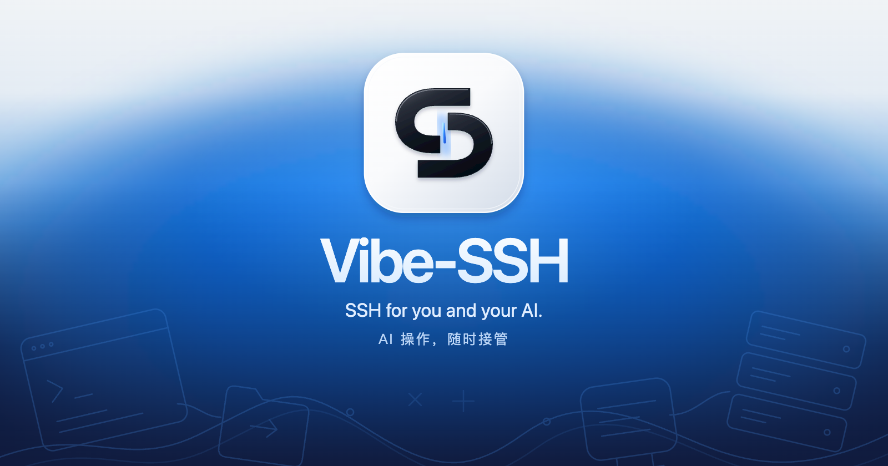
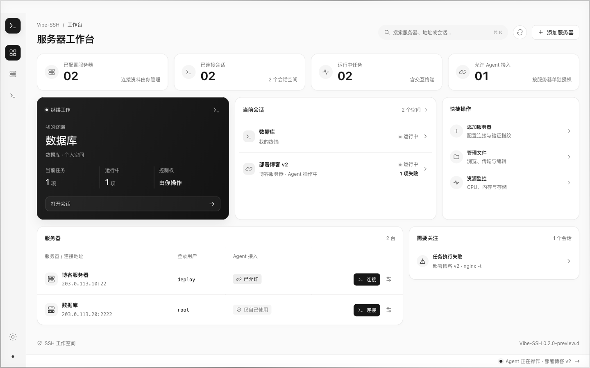
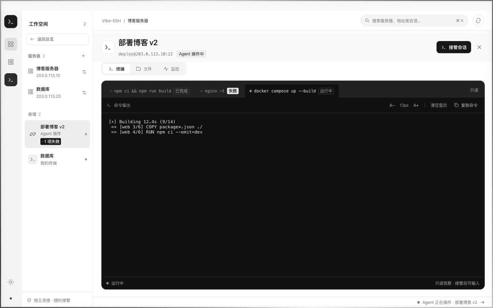
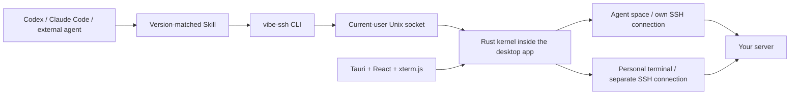

<h1 align="center">Vibe-SSH</h1>

<h3 align="center">The SSH workspace for you and your AI.</h3>

<p align="center">
  <a href="LICENSE"></a>
  <a href="https://github.com/IntMainJhy/Vibe-SSH/releases"></a>
  <a href="https://github.com/IntMainJhy/Vibe-SSH/actions/workflows/rust.yml"></a>
  <a href="docs/installation.en.md"></a>
</p>

<p align="center">
  An open-source macOS SSH/SFTP client for <strong>Codex, Claude Code and other external AI agents</strong>.<br />
  Add your servers manually. Deploy and troubleshoot through Skills.<br />
  <strong>Watch commands and output in real time. Take over whenever you need.</strong>
</p>

<h3 align="center"><a href="https://github.com/IntMainJhy/Vibe-SSH/releases">Download the macOS preview</a></h3>

<p align="center">
  <a href="#what-you-can-do">Features</a> &nbsp;·&nbsp;
  <a href="docs/installation.en.md">Installation</a> &nbsp;·&nbsp;
  <a href="skills/vibe-ssh/guide.md">Agent guide</a> &nbsp;·&nbsp;
  <a href="docs/README.md">Documentation</a> &nbsp;·&nbsp;
  <a href="ROADMAP.md">Roadmap</a> &nbsp;·&nbsp;
  <a href="CONTRIBUTING.md">Contribute</a>
</p>

<p align="center">
  <strong>English</strong> · <a href="README.zh-CN.md" lang="zh-CN">简体中文</a>
  &nbsp;|&nbsp;
  <a href="https://github.com/IntMainJhy/Vibe-SSH">GitHub</a> · <a href="https://gitcode.com/InMainJhy/Vibe-SSH">AtomGit</a>
</p>

<p align="center">Your terminals and agent task spaces stay separate, each with its own SSH connection.</p>

> **Preview software:** packages target Apple silicon and Intel Macs. Linux is a remote-server target, not a desktop release. Packages are ad-hoc signed and are not yet Developer ID signed or notarized. See [project status](#project-status).



*The actual application interface running with development sample data. Server names, addresses and task output in the screenshot are examples.*

## What you can do

| Capability | How it works |
| --- | --- |
| Use SSH yourself | Manually configure hosts, verify fingerprints, and open tabbed terminals with search, themes and adjustable text size. |
| Give an agent a server task | Enable access for a host. An external agent loads the Skill and uses the version-matched CLI. |
| See the work happen | Inspect commands, task state and terminal output while the agent works. |
| Take over and return control | Taking over blocks new agent writes in that space. Returning control issues a new lease; old leases stay invalid. |
| Move and edit files | Browse SFTP directories, transfer files, and edit bounded UTF-8 text with version checks and backups. |
| Compare project directories | Preview metadata and ignore rules, then hash only selected regular files. No automatic synchronization or deletion. |
| Read retained tasks | Browse bounded command/output history after restart. Unknown outcomes stay unknown; commands and leases are never replayed. |
| Inspect Linux resources | View CPU, memory, swap, load, uptime and root-filesystem usage. Samples are collected while monitoring is visible. |
| Deploy a website | Use the Skill's static-site/Nginx or Docker Compose reference flow, with service checks and failure handling. |

Vibe-SSH connects the AI agent you already use to your SSH workflow. The application itself does not run a model or make autonomous deployment decisions.

## Install and connect

1. Download a preview from [Releases](https://github.com/IntMainJhy/Vibe-SSH/releases). Choose `macos-arm64` for Apple silicon or `macos-x86_64` for Intel. Each release includes DMG/ZIP packages and `SHA256SUMS.txt`.
2. Move `Vibe-SSH.app` to **Applications** and open it. Follow the [installation guide](docs/installation.en.md) for checksum verification and macOS's per-app opening procedure.
3. Add a server yourself: name, address, port, username, and password or private key. Verify the host fingerprint through a trusted channel before saving.
4. Open a terminal for your own work. To let an agent use the server, enable agent access for that host.

On startup and upgrade, the app synchronizes its Skill links for compatible agents and its CLI link at `~/.local/bin/vibe-ssh`. Unrelated existing entries are preserved. Paths and uninstall behavior are in the installation guide.

## Let Codex or Claude Code operate it

Keep Vibe-SSH running, then give your agent a server and a goal. For example:

> Use Vibe-SSH to deploy this project's built site to my blog server. Check the existing configuration, preserve the working release, and verify the URL after deployment.

The agent starts by reading the installed guide:

```sh
vibe-ssh skill
# If the command is not on PATH:
"$HOME/.local/bin/vibe-ssh" skill
```

That guide describes the installed version: host discovery, one task space per goal, command execution, incremental output, uploads and handoff. Compatible agents that can read Skills and execute local commands can use the CLI; independent end-to-end evidence still needs to be recorded for each agent.

<details>
<summary>Example CLI interaction</summary>

The placeholders come from the preceding command's JSON response. Agents manage these IDs and leases during normal use.

```sh
vibe-ssh hosts
vibe-ssh space open <host-id> --name "inspect deployment" --actor "Codex"
vibe-ssh run --lease <lease> -- 'uname -a'
```

Long tasks return a cursor for `job wait`. A wait expiring does not mean the task failed. Read the [full guide](skills/vibe-ssh/guide.md) before operating a server.

</details>

Deployment reference flows:

```sh
vibe-ssh skill static-site   # built static files served by Nginx
vibe-ssh skill compose       # an existing Docker Compose project
```

## Watching and taking over

An agent's task space groups its commands, terminals and control state. Keep working in your own terminal while observing that space.

Taking over makes the kernel reject subsequent agent commands, input, uploads, interruptions and close operations for that space. Already-running commands continue until they finish or you explicitly interrupt them. An agent can also hand over when a password or human decision is needed.

Returning control creates a new lease. The agent must read updated state before continuing. Personal terminal spaces are not exposed through the agent interface. Manual host management and fingerprint trust are not agent socket methods.



*Session screenshot uses the application's development sample data.*

## Project status

The current release line is **0.2.0 preview**. The main branch includes the macOS desktop client, isolated agent spaces, SFTP operations, bounded text editing, Linux monitoring and version-matched Skill/CLI integration.

The desktop interface currently uses Simplified Chinese. The CLI guide and these community docs are available in English.

Validation records cover temporary OpenSSH servers and an isolated Debian 13 VM: execution, upload, interruption, takeover, password handoff and the two deployment flows. These scoped records do not establish that every agent has independently deployed an application or that public-server deployment is universally verified.

Preview 5 adds read-only directory comparison and bounded task/output history. Each history stream retains at most 64 KiB of raw tail; it is not a full audit log. The CLI provides `diff` and `history list/get`, with personal history hidden from agents. See [ADR 0006](docs/adr/0006-directory-diff-preview.md) and [ADR 0007](docs/adr/0007-task-history.md) for selection, budgets and storage semantics.

Native host setup, verified fingerprints, Chinese terminal input, transfers, editing, takeover/return and quit protection have been exercised through the real window. An encrypted-key passphrase survived restart in an isolated real macOS Keychain. M3 native replay also passed directory selection, selected-content comparison and history streams/restart outcomes after an intermittent ScreenCaptureKit capture error was resolved. Clean-system installation, Developer ID/notarization, independent agent deployment, SSH-agent authentication, jump hosts, port forwarding and other desktop platforms remain outstanding.

See the [implementation and evidence log](docs/06-development-and-status.md), [roadmap](ROADMAP.md) and [release notes](CHANGELOG.md).

## Architecture



Rust/Tokio and [russh](https://github.com/Eugeny/russh) handle SSH. Tauri 2, React/TypeScript and [xterm.js](https://github.com/xtermjs/xterm.js) provide the desktop interface. Connections are reused within each task space. Protocol v2 exposes agent operations, while manual configuration and control stay inside the application.

Read the [architecture decisions](docs/adr/0002-task-spaces-and-agent-neutrality.md) and [agent protocol](docs/03-agent-protocol.md) for the boundaries and failure semantics.

## Build from source

Build on macOS with Rust **1.89 or newer**, Node.js **24**, Xcode Command Line Tools and the [Tauri macOS prerequisites](https://v2.tauri.app/start/prerequisites/).

```sh
git clone https://github.com/IntMainJhy/Vibe-SSH.git
cd Vibe-SSH

cd apps/desktop
npm ci
npm test
npm run build
cd ../..

cargo fmt --all -- --check
cargo clippy --workspace --all-targets --locked -- -D warnings
cargo test --workspace --locked

cd apps/desktop
npx tauri build
```

The desktop crate embeds the built frontend: build the frontend before checking the Rust workspace. Native end-to-end tests use macOS's `/usr/sbin/sshd` with temporary directories and identities.

For the isolated Linux VM and deployment examples, see [Contributing](CONTRIBUTING.md). A browser-only development preview uses sample data and does not connect to servers.

## FAQ

**Does Vibe-SSH include its own AI model?**

It uses external agents through Skills and a CLI. Keep using your existing agent environment.

**Can I use it as a regular SSH client?**

Yes. Configure hosts and use terminals, files and monitoring yourself; agent access is enabled per host.

**Do I need a Vibe-SSH service on my VPS?**

The app connects over SSH. Operations still need their usual server-side tools, such as `tar`, Nginx or Docker.

**Is it faster than a traditional SSH tool?**

The design reduces repeated setup and makes output and task state directly available to agents. A [scoped loopback benchmark](docs/performance/2026-11-17-loopback.json) exists; it does not establish a general speedup for public networks or full deployments.

**Are Windows and Linux desktop clients available?**

Current packages are for macOS. Linux is a remote-server target. Other desktop platforms are on the [roadmap](ROADMAP.md).

## Community and documentation

- [Report a bug](https://github.com/IntMainJhy/Vibe-SSH/issues/new/choose) with your version and reproducible steps.
- [Ask a question or share a workflow](https://github.com/IntMainJhy/Vibe-SSH/discussions).
- [Contribute](CONTRIBUTING.md), review the [code of conduct](CODE_OF_CONDUCT.md), or read the [support guide](SUPPORT.md).
- [Report security issues privately](SECURITY.md).
- Browse the [technical documentation](docs/README.md), [design system](DESIGN.md) and [agent Skill](skills/vibe-ssh/SKILL.md).

## License

Vibe-SSH is available under the [MIT License](LICENSE). Third-party components retain their own licenses; release packaging maintains separate [third-party notices](third_party/licenses/README.md).
