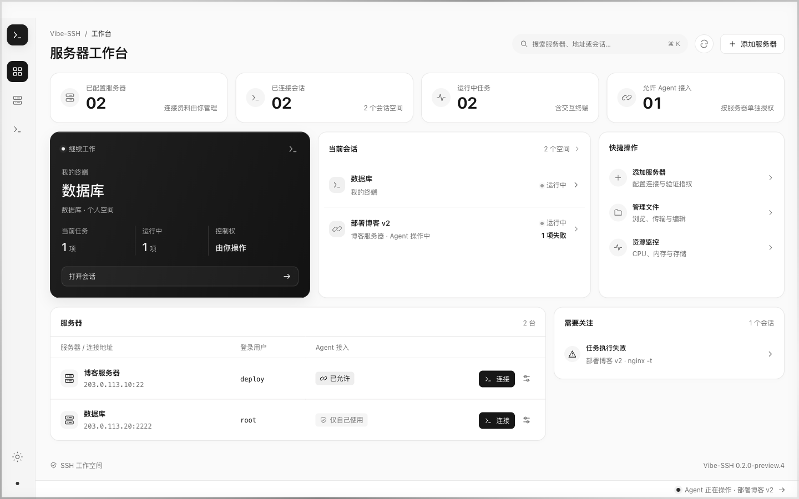
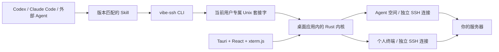

# Vibe-SSH

**供用户与外部 AI Agent 共同使用的桌面 SSH 客户端。**

[](LICENSE)
[](https://github.com/IntMainJhy/Vibe-SSH/releases)
[](https://github.com/IntMainJhy/Vibe-SSH/actions/workflows/rust.yml)
[](docs/installation.md)

[English](README.md) · 简体中文

[GitHub 主仓库](https://github.com/IntMainJhy/Vibe-SSH) · [AtomGit 镜像](https://gitcode.com/InMainJhy/Vibe-SSH)

Vibe-SSH 是开源的 macOS SSH/SFTP 客户端。你像使用日常 SSH 工具一样手动添加服务器，**Codex、Claude Code 等外部命令行 Agent** 通过 Skill 调用客户端，帮你执行指令、部署网站和排查服务器问题。

Agent 操作时，你能在应用里查看命令、输出和任务状态，随时接管它的任务空间。你自己的终端与 Agent 空间分别使用独立 SSH 连接，可以并行工作。

[下载 macOS 预览版](https://github.com/IntMainJhy/Vibe-SSH/releases) · [安装说明](docs/installation.md) · [Agent 使用指南](skills/vibe-ssh/guide.md) · [路线图](ROADMAP.md) · [参与贡献](CONTRIBUTING.md)

> **当前为预览版：**提供 Apple 芯片与 Intel Mac 安装包。Linux 是远端服务器目标，目前没有 Windows/Linux 桌面包。应用使用临时签名，尚未完成 Developer ID 签名与 Apple 公证。能力与验证范围见下文。



*截图来自实际应用界面的开发预览，使用示例服务器、地址和任务数据。*

## 可以做什么

| 能力 | 使用方式 |
| --- | --- |
| 日常 SSH | 手动填写服务器信息、核对指纹，使用多标签终端、搜索、外观切换与字号设置。 |
| 外部 AI 操作 | 逐台开启 Agent 接入，Agent 读取 Skill 后通过版本匹配的 CLI 操作。 |
| 观看执行过程 | 打开 Agent 空间，查看指令、任务状态和终端输出。 |
| 人工接管 | 接管后内核拒绝空间里的新 Agent 写操作；归还生成新租约，旧租约保持失效。 |
| 文件传输与编辑 | SFTP 浏览、上传下载，查看和编辑有大小限制的 UTF-8 文本，保存时进行版本检查并保留备份。 |
| Linux 资源监控 | 查看 CPU、内存、交换空间、负载、运行时间和根分区用量，监控页可见时采样。 |
| 网站部署 | 使用静态站点/Nginx 与 Docker Compose 参考流程，包含验证和失败处理。 |

Vibe-SSH 把你已有的 AI Agent 接入 SSH 工作流。客户端本身不运行模型，也不替 Agent 作出自主部署决策。

## 安装与首次连接

1. 在 [Releases](https://github.com/IntMainJhy/Vibe-SSH/releases) 选择安装包：Apple 芯片选 `macos-arm64`，Intel 选 `macos-x86_64`。每次发布附 DMG、ZIP 和 `SHA256SUMS.txt`。
2. 把 `Vibe-SSH.app` 移入“应用程序”后启动。校验和与 macOS 单次允许打开的步骤见[安装说明](docs/installation.md)。
3. 手动输入服务器名称、地址、端口、用户名、密码或私钥，通过可信渠道核对指纹后保存。
4. 打开你自己的终端。需要 AI 操作时，再为这台主机开启 Agent 接入。

应用启动及升级时会同步兼容 Agent 的 Skill 链接，并创建 `~/.local/bin/vibe-ssh` 命令链接；无关的已有同名内容会保留。详细路径、移动应用和卸载行为见安装说明。

## 让 Codex 或 Claude Code 使用

保持 Vibe-SSH 运行，在 Agent 对话里说明服务器和具体目标，例如：

> 通过 Vibe-SSH 把这个项目构建后的站点部署到我的博客服务器。先检查现有配置，保留当前可用版本，部署后验证网站地址。

Agent 首先读取与已安装应用匹配的说明：

```sh
vibe-ssh skill
# PATH 没有包含命令目录时：
"$HOME/.local/bin/vibe-ssh" skill
```

说明包含授权主机列表、每个目标的任务空间、执行指令、增量输出、上传与交接。能读取 Skill 并执行本机命令行的兼容 Agent 可以使用这些接口；每种 Agent 的独立部署验证仍需记录具体证据。

<details>
<summary>命令行调用示例</summary>

下方主机 ID 与租约来自前一步 JSON 返回值，日常使用时由 Agent 管理。

```sh
vibe-ssh hosts
vibe-ssh space open <host-id> --name "检查部署环境" --actor "Codex"
vibe-ssh run --lease <lease> -- 'uname -a'
```

长任务返回游标，通过 `job wait` 继续等待。等待到期不代表任务失败。操作前阅读[完整指南](skills/vibe-ssh/guide.md)。

</details>

部署参考流程：

```sh
vibe-ssh skill static-site   # 构建后的静态站点，通过 Nginx 提供服务
vibe-ssh skill compose       # 已有 Docker Compose 的项目
```

## 观看、接管与归还

Agent 的指令、终端和控制权归属于任务空间。你可以在自己的终端里照常工作，同时观察 Agent 空间。

接管后，内核拒绝这个空间里的后续 Agent 指令、输入、上传、中断与关闭操作。已运行的命令继续执行，直到完成或由你明确中断。Agent 遇到密码或需要人作决定时，也可以主动交接。

归还会产生新租约，Agent 必须读取最新状态后继续。你的个人终端不向 Agent 暴露；添加主机、信任指纹、开启接入和人工接管不属于 Agent 套接字接口。


*会话截图使用应用自带的开发示例数据。*

## 当前状态与边界

当前发布线为 **0.2.0 预览版**。主分支已有 macOS 客户端、隔离的 Agent 任务空间、SFTP 文件操作、有界文本编辑、Linux 监控，以及版本匹配的 Skill/CLI 接入。

桌面界面当前使用简体中文，CLI 指南与社区文档提供英文入口。

已有工程记录覆盖临时 OpenSSH 服务和隔离 Debian 13 虚拟机上的执行、上传、中断、接管、密码交接与两种部署流程。这些证据有明确范围，不代表每种 Agent 都已独立完成部署，也不代表已普遍验证公网服务器。

Preview 5 新增只读目录差异预览与任务/输出历史。先看两端元数据和忽略范围，再只哈希明确选择的普通文件；不会自动同步、覆盖或删除。历史每路保留最多 64 KiB 原始输出尾部，不是全量审计。CLI 新增 `diff` 和 `history list/get`，Agent 不可读取个人历史。选择、预算、持久化和重启语义见 [ADR 0006](docs/adr/0006-directory-diff-preview.md) / [ADR 0007](docs/adr/0007-task-history.md)。

原生核心流程已验证主机录入、独立指纹核对、中文终端、上传下载、编辑保存、并行使用、接管归还和退出保护；加密私钥口令在隔离真实 Keychain 中通过重启连接。M3 追加原生窗口复验遭遇 ScreenCaptureKit -3811，未计为原生点击通过。干净系统安装卸载、正式签名/公证、真实 Agent 独立部署、SSH-agent 认证、跳板机、端口转发和其他桌面平台仍待完成。

详见[开发与验证记录](docs/06-development-and-status.md)、[路线图](ROADMAP.md)和[更新日志](CHANGELOG.md)。

## 技术架构



Rust/Tokio 和 [russh](https://github.com/Eugeny/russh) 负责 SSH，Tauri 2、React/TypeScript 和 [xterm.js](https://github.com/xtermjs/xterm.js) 构成界面。连接只在同一任务空间内复用。Agent 使用协议 v2，人工管理操作留在应用进程内部。

决策与故障语义见[任务空间 ADR](docs/adr/0002-task-spaces-and-agent-neutrality.md)和[协议设计](docs/03-agent-protocol.md)。

## 从源码构建

在 macOS 上安装 Rust **1.89 或更新版本**、Node.js **24**、Xcode Command Line Tools，并满足 [Tauri 的前置要求](https://v2.tauri.app/start/prerequisites/)。

```sh
git clone https://github.com/IntMainJhy/Vibe-SSH.git
cd Vibe-SSH

cd apps/desktop
npm ci
npm test
npm run build
cd ../..

cargo fmt --all -- --check
cargo clippy --workspace --all-targets --locked -- -D warnings
cargo test --workspace --locked

cd apps/desktop
npx tauri build
```

桌面 crate 在编译时嵌入前端产物，因此先构建前端，再检查 Rust 工作区。原生端到端测试使用 macOS 的 `/usr/sbin/sshd` 和临时目录、临时密钥。

隔离 Linux 测试虚拟机和部署样例见[贡献指南](CONTRIBUTING.md)。浏览器开发预览只使用示例数据，不连接服务器。

## 常见问题

**需要另外配置模型吗？**

Vibe-SSH 通过 Skill 和 CLI 接入外部 Agent，继续使用已有的 Agent 环境。

**可以单纯当 SSH 工具使用吗？**

可以。终端、文件和监控由你直接使用，主机是否开放给 Agent 单独设置。

**服务器需要安装 Vibe-SSH 服务吗？**

客户端通过 SSH 连接；操作仍需要正常的远端工具，例如上传使用的 `tar`，以及部署需要的 Nginx 或 Docker。

**一定比传统 SSH 工具快吗？**

设计重点是减少重复配置，让 Agent 直接获取输出与状态。[回环基准](docs/performance/2026-11-17-loopback.json)有明确范围，不能推导公网或完整部署的一般提速结论。

**支持 Windows 或 Linux 桌面吗？**

当前安装包只面向 macOS，Linux 用作远端服务器目标。其他桌面平台见[路线图](ROADMAP.md)。

## 社区与文档

- [报告问题](https://github.com/IntMainJhy/Vibe-SSH/issues/new/choose)，提供版本和复现步骤。
- [提问或分享流程](https://github.com/IntMainJhy/Vibe-SSH/discussions)。
- 阅读[贡献指南](CONTRIBUTING.md)、[行为准则](CODE_OF_CONDUCT.md)与[支持说明](SUPPORT.md)。
- 安全问题按[安全策略](SECURITY.md)私下报告。
- 技术细节见[方案总览](docs/README.md)、[界面规范](DESIGN.md)与[Agent Skill](skills/vibe-ssh/SKILL.md)。

## 开源协议

Vibe-SSH 采用 [MIT License](LICENSE)。第三方组件保留各自许可证，发行包单独维护[第三方声明](third_party/licenses/README.md)。
