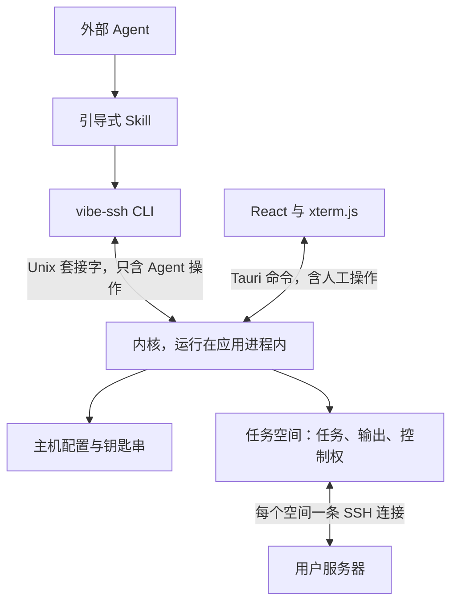
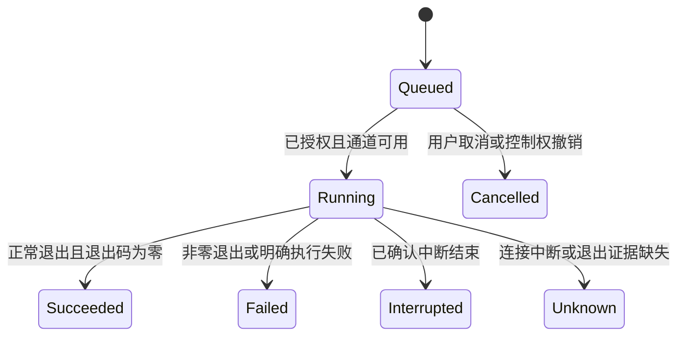

# Vibe-SSH 系统架构

## 架构目标

让桌面用户与外部 Agent（Agent、Claude Code 等）共享同一个 SSH 执行事实源。界面负责呈现与人工输入，CLI 负责机器调用，内核负责连接、任务、输出和控制权。所有可影响远端的动作经过内核。

## 进程结构



内核是本机单用户进程的一部分，不是安装在服务器上的程序。桌面应用就是常驻服务；开发时可用 `vibe-ssh serve` 无界面运行。应用退出后空间与任务随之结束。应用崩溃、系统休眠或断网不等同于远端进程已停止。

数据库与任务的持久记录尚未实现，不通过空壳接口宣称已具备。

## 技术选型

| 部位 | 选型 | 原因 |
| --- | --- | --- |
| 桌面壳 | Tauri 2 | 原生后台与 Web 界面分层，面向 macOS/Windows 打包 |
| 界面 | React、TypeScript、Vite | 终端周边界面开发与类型约束 |
| 终端呈现 | xterm.js | 复用终端渲染与输入生态 |
| 内核和 CLI | Rust、Tokio | 原生 CLI、异步 I/O、共享类型和清晰资源所有权 |
| SSH | russh | 复用认证、通道与交互能力 |
| 上传 | exec 通道上的 tar 流 | 一次往返传完目录；逐文件语义需要时再引入 SFTP |
| 元数据 | 主机为 JSON 文件；任务记录计划用 SQLite | 当前数据量不需要数据库 |
| 凭据 | macOS 钥匙串 | 与普通主机配置分离 |
| 本地协议 | JSON 请求与响应，受限帧大小 | 易调试、可版本化、机器可读 |

使用 Unix 套接字，目录 0700、套接字 0600，并校验对端用户，不绑定 TCP 端口。人工管理操作不在套接字协议中，只能由应用进程内部调用。

## 模块与依赖方向

协议类型不依赖 UI、SSH 或存储。领域层依赖协议和接口抽象。SSH、凭据、数据库及 IPC 是适配实现。CLI 和桌面壳依赖客户端入口，不直接修改任务存储。

目标模块如下，按里程碑逐步创建：

```text
crates/
  protocol/       请求结果、错误码、状态和控制权类型
  core/           连接、执行、输出、控制权与适配器
  cli/            已实现能力的命令行入口
apps/
  desktop/        Tauri 壳与 React 界面；同一个可执行文件被链接为 vibe-ssh 时就是 CLI
skills/
  vibe-ssh/       与可用命令同步的 Skill
docs/            产品、架构、契约、验收与决策
```

首版不引入微服务、消息队列或远程控制平面。模块边界用于隔离变化，不要求每个模块成为一个进程或独立 crate。

## 主机和连接

主机包含稳定 ID、显示名称、地址、端口、账号、私钥路径、用户核对过的指纹及 Agent 接入开关。每个任务空间在打开时建立自己的连接，不同空间不共用连接。

空间内的任务在该连接上各开一个通道。空间数量与每空间同时运行的任务数均有上限，超出返回明确错误。

连接状态：未连接、连接中、等待用户验证、可用、断开、关闭。主机密钥不匹配时阻止认证和后续动作，用户处理后再显式重连。

## 两类执行路径

### 命令任务

每次任务显式声明远端命令、工作目录、环境引用和可选 PTY。通过 SSH exec 通道收集数据、错误流、退出码和退出信号。收到退出状态后继续排空剩余数据，不能提前丢失尾部输出。

默认任务在独立 Shell 上下文运行。一次任务里的 `cd` 或 `export` 不会自动改变下一任务；接口要求显式传递上下文。复用的是 SSH 连接，不是未经声明的 Shell 隐含状态。

PTY 任务可在运行期间接受输入并支持人工接管；标准输出和错误输出可能合并，结果类型须标注。任务结束后保留输出，不伪装成仍可输入的 Shell。

### 持续交互终端

人工日常 SSH 使用持续 PTY Shell。AI 可观察屏幕快照、增量原始输出并在拥有输入权时发送文本或控制按键。窗口大小使用同一通道同步。

持续 Shell 的目录和逐命令退出状态只有在可靠 Shell 集成存在时才声明；嵌套 Shell、tmux 或 TUI 状态不明时返回未知。首版不靠提示符匹配来伪造结构化任务完成。

## 任务状态



等待调用超时只表示本次观察结束，任务可以仍为 Running。请求取消与远端进程退出分开记录；没有证据时不能返回 Interrupted。未知结果通过重新连接后检查服务或产物解决，不自动重放。

## 任务空间与控制权

任务空间绑定一台主机，拥有一条连接、若干任务和一个控制权状态：持有者（Agent 或用户）、当前租约、交接原因。Agent 打开的空间初始由 Agent 持有；用户打开的空间永远由用户持有，对 Agent 不可见。

Agent 的每个写操作携带租约。租约校验与向通道提交数据在空间的同一把锁内完成；接管先在锁内更换租约，再向界面确认，因此确认之后不会有 Agent 的字节被提交。已经交给网络的字节无法撤回。打开通道没有远端副作用，放在锁外，慢服务器不会拖住接管。

接管、交接和归还都更换租约。归还后 Agent 必须重新读取空间状态；内核不恢复旧请求，也不生成下一条命令。控制权变化不终止进程。输出不受控制权限制，可以同时被多个观察者读取。

## 输出与事件

原始数据以字节为准，不假设每个网络包正好是 UTF-8 字符边界。显示解码、原始文件保存和机器摘要分离，最终解码只能在消息边界或流尾正确处理半个字符。

空间、任务、租约和游标都带有服务实例标识。重启后生成新的实例标识，旧标识返回实例不匹配，不会悄悄指向新任务。游标是输出的字节偏移。

内存缓冲设上限（每路输出 1 MiB），磁盘日志尚未实现。游标已过期时返回最早可用位置、截断标识和可用证据，不返回看似完整的日志。默认返回少量尾部或新增输出；大量内容按需获取。

慢 UI 不能阻塞内核读取 SSH 数据。采用有界队列、批量刷新和背压策略；丢弃观察通知时必须标记缺口，并允许重新读取保留数据。

## 文件与持久化

SQLite 保存主机、项目、部署、任务摘要、控制权事件和迁移版本，凭据使用系统存储引用。原始输出与文件产物单独保存，按大小和保留期轮换。

文件编辑使用读取时的摘要或版本条件检测冲突。临时文件加重命名在支持条件下完成替换；跨文件系统和服务器扩展不支持时说明降级语义。目录同步默认不删除远端额外文件，排除 `.git`、依赖目录和用户未明确选择的秘密文件。

数据库写入使用事务。升级前检查 schema 版本并备份元数据；迁移失败不继续启动修改服务，不能让新旧版本同时写同一数据目录。
