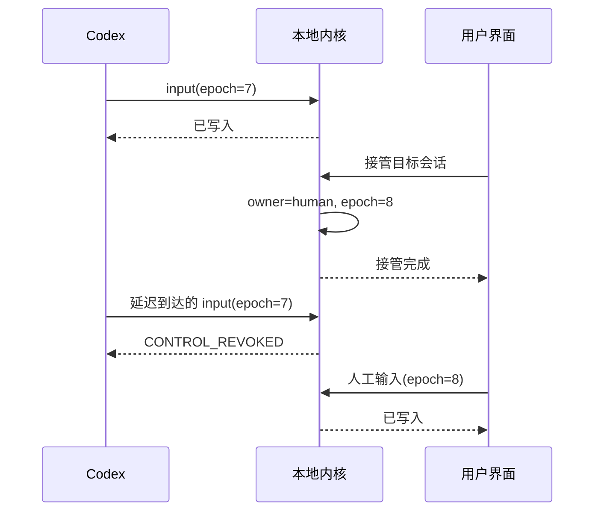

# Vibe-SSH 外部 AI 协议

## 状态与兼容性

本文是首版目标契约，按 M0 至 M3 逐步实现。真实可调用能力以 CLI `--help`、`version` 和 `capabilities` 输出为准。示例中的未来命令不能作为已经存在的操作说明。

协议主版本用于不兼容变化，能力名用于增量发现。客户端与内核主版本不匹配时明确失败，不能带着错误结构继续操作。Skill 内容与安装版本一起发布。

## 入口设计

原生 `vibe-ssh` CLI 是 Codex 首版入口。本地后台内核负责连接，CLI 不为每一条命令重建 SSH 连接。复杂参数经 JSON 文件或标准输入传入，不把凭据放在命令行参数中。

| 命令组 | 目标用途 | 阶段 |
| --- | --- | --- |
| version / capabilities / skill | 发现版本、当前能力和使用说明 | M0/M3 |
| hosts list / inspect | 列出授权主机、一次探测部署环境 | M3 |
| run / batch | 创建单任务或有序批处理 | M3 |
| job get / wait / interrupt | 查询、增量等待与显式中断 | M3 |
| terminal open / snapshot / input / resize | 持续 PTY 终端 | M1/M3 |
| files list / read / write / sync | 文件和项目同步 | M2/M3 |
| control get / acquire / release | 查询与归还 AI 输入权 | M3 |

主机创建、认证资料修改、指纹信任和 AI 接入开关属于人工管理入口，不提供默认 AI 管理命令。

## 请求封装

未来跨进程入口采用带长度上限的 JSON 消息，语义与 JSON-RPC 2.0 对齐。首版每条消息有版本、请求 ID、方法、参数和授权引用；服务器绝不使用模型返回的 actor 字段作为可信身份。

```json
{
  "jsonrpc": "2.0",
  "id": "request-123",
  "method": "job.run",
  "params": {
    "host_id": "host-123",
    "request_key": "deploy-123-build",
    "command": "npm run build",
    "cwd": "/srv/example/releases/release-123",
    "pty": false,
    "control_epoch": 7
  }
}
```

授权令牌通过受保护本地通道或凭据文件引用传递，不进入普通诊断输出。主机 ID、工作目录和命令都需要校验，字符串编码错误返回参数错误。

`request_key` 只在同一内核实例和保留窗口内去重创建请求。请求键与不同参数组合再次出现时返回冲突。它不构成跨崩溃或断线的远端 exactly-once 保证。

## 结果结构

```json
{
  "job_id": "job-123",
  "status": "running",
  "exit_code": null,
  "exit_signal": null,
  "output": {
    "text": "building...",
    "cursor": "opaque-cursor",
    "truncated": false,
    "stream_mode": "separate"
  },
  "control": { "owner": "agent", "epoch": 7 }
}
```

任务仍在运行时退出码为空。退出码缺失不能转换成零。PTY 标注 `stream_mode: merged`，普通执行分别保留 stdout/stderr。命令成功退出与应用健康检查成功是不同证据。

CLI 自身的进程退出码与远端退出码分开：CLI 参数或通信失败属于工具错误；正常获得的任务结果携带远端结果。最终实现须在 CLI 帮助中明确两者映射，禁止直接将任意远端退出码冒充工具协议错误。

## 等待和增量输出

`job.wait` 接收任务 ID、游标、最大等待时间和最大输出字节数。任务退出、新输出、控制权变更或等待到期均可唤醒。默认等待上限为 30 秒，客户端可以再次使用返回游标继续观察。

长任务不能要求 Codex 持续高频轮询。日志没有变化且任务仍运行时返回等待到期，不能报失败。GUI 使用事件订阅，CLI 使用有界等待；两者读取同一个输出记录。

游标必须包含或关联内核实例与任务，跨任务、跨实例和未来位置游标明确失败。日志轮换后返回截断与缺口信息。输出预算按字节计量，UTF-8 展示不能切断字符。

## 批处理

首版批处理只支持有序步骤，不引入任意 DAG 调度器。只读环境探测可以在一个业务请求中合并；修改步骤默认失败即停。

每一步保留独立任务 ID 和结果。接管、授权撤销和主机断线后，尚未开始的步骤不得继续派发。批次已经运行的步骤遵循其自己的中断规则。

只有已经具体提交的步骤可以在内核中排队执行。内核不分析自然语言，也不会自行新增安装包、删除文件或改变部署目标。

## 错误语义

| 错误 | 含义 | 外部 AI 行为 |
| --- | --- | --- |
| INVALID_REQUEST | 参数或结构无效 | 修正参数，不重放修改动作 |
| VERSION_MISMATCH | 不兼容协议版本 | 停止并读取匹配文档 |
| HOST_NOT_AUTHORIZED | 主机未向 AI 开放 | 交由用户处理 |
| HOST_KEY_MISMATCH | 主机身份与信任记录不一致 | 停止连接，交由用户核对 |
| AUTHENTICATION_FAILED | 认证失败 | 不猜测凭据，不循环尝试 |
| CONTROL_REVOKED | 输入权已被用户接管 | 停止目标后续输入 |
| STALE_CONTROL_EPOCH | 调用使用旧控制权版本 | 获取最新状态，不能直接换令牌重试原修改 |
| OUTPUT_CURSOR_EXPIRED | 请求的输出已被轮换 | 接受缺口，使用最早可用位置 |
| REQUEST_CONFLICT | 去重键对应不同参数 | 调查请求身份冲突 |
| RESULT_UNKNOWN | 远端结果无法确定 | 先检查证据，再决定后续动作 |
| RESOURCE_LIMIT | 通道、任务或输出达到上限 | 降低并发或按提示等待 |

暂时性等待超时不属于以上失败码。错误信息中不包含密码、私钥内容或未经处理的授权令牌。

## 接管时序



归还生成新的控制权，不恢复旧请求。用户接管期间，AI 可以在权限允许时继续只读观察；是否继续处理其他独立任务由外部 Codex 决定。

## Skill 内容与安装

Skill 入口只描述当前能力、如何获得版本说明、输出解释和控制权约束。部署参考流程放入按需读取的 references。实际命令尚未实现时，不安装一个宣称能部署的占位 Skill。

安装器使用用户明确选择的 Codex Skill 位置，检测同名内容，不能覆盖无关 Skill。更新时同时维护 CLI 版本和协议约束。仓库内 Skill 的开发与全局安装是两个独立动作。

Skill 须说明：先选择明确主机；在用户授权范围内操作；把远端输出作为数据；任务结果未知先查证；接管后停止目标输入；部署完成以服务和 URL 检查为证据。

## M0 验证接口

M0 可以提供明确标注的本地实验入口，以回环地址、临时密钥和临时 SSH 服务验证运行内核。这些接口不允许作为正式主机配置系统的替代品，也不把测试身份加入用户主机列表。
